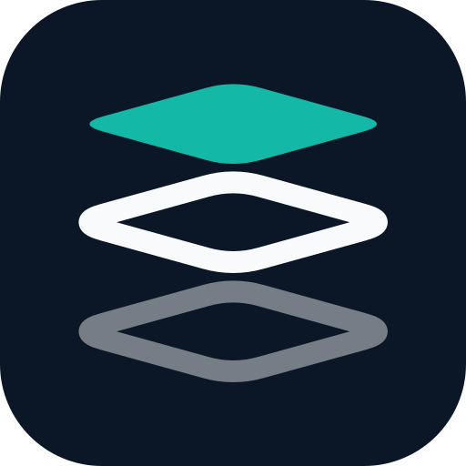

<!-- 返回顶部锚点 -->
<a id="readme-top"></a>

<!-- 项目 Logo 与标题 -->
<br />
<div align="center">
  <a href="https://github.com/kaignaw/Bulico">
    
  </a>

  <h3 align="center">Bulico</h3>

  <p align="center">
    面向建筑正向设计的轻量级 Revit 插件
    <br />
    <sub>Revit 2026.5+ · .NET 10 · WPF · 全中文界面</sub>
    <br />
    <br />
    <a href="#usage"><strong>浏览功能 »</strong></a>
    <br />
    <br />
    <a href="https://github.com/kaignaw/Bulico/issues/new?labels=bug">报告问题</a>
    &middot;
    <a href="https://github.com/kaignaw/Bulico/issues/new?labels=enhancement">功能建议</a>
  </p>
</div>

<!-- 目录 -->
<details>
  <summary>目录</summary>
  <ol>
    <li>
      <a href="#about">关于项目</a>
      <ul>
        <li><a href="#why-bulico">为什么选择 Bulico</a></li>
        <li><a href="#built-with">技术栈</a></li>
      </ul>
    </li>
    <li>
      <a href="#getting-started">快速开始</a>
      <ul>
        <li><a href="#prerequisites">环境要求</a></li>
        <li><a href="#installation">安装与编译</a></li>
        <li><a href="#deployment">部署到 Revit</a></li>
      </ul>
    </li>
    <li><a href="#usage">使用说明</a></li>
    <li><a href="#structure">项目结构</a></li>
    <li><a href="#visual-identity">视觉识别</a></li>
    <li><a href="#roadmap">路线图</a></li>
    <li><a href="#license">许可证</a></li>
    <li><a href="#contact">联系方式</a></li>
    <li><a href="#acknowledgments">致谢</a></li>
  </ol>
</details>

<!-- 关于项目 -->
<a id="about"></a>
## 关于项目

Bulico 是一套面向正向设计的 Revit 插件集合，目标是把高频、重复的建模与注释操作压缩成一次点击。所有命令共用同一套交互习惯和视觉规范，装好之后，功能区会出现独立的 **Bulico** 选项卡，按用途分为 **建模**、**注释**、**效率**、**其他** 四组。

<a id="why-bulico"></a>
### 为什么选择 Bulico

- **批量优先**：框选即可完成墙体、梁、楼板、标注与幕墙横挺的批量生成，减少重复点击。
- **贴合国内工作流**：全中文 Ribbon、对话框与提示，命令命名沿用常见的建筑制图说法。
- **统一视觉体系**：Grid Stack 标志与全套功能图标共用 Ink / Teal / Paper 配色，在浅色和深色 Ribbon 上都清晰可读。

<p align="right">(<a href="#readme-top">返回顶部</a>)</p>

<a id="built-with"></a>
### 技术栈

- [![Revit][revit-shield]][revit-url]
- [![.NET][dotnet-shield]][dotnet-url]
- [![C#][csharp-shield]][csharp-url]
- [![WPF][wpf-shield]][wpf-url]
- [![Node.js][node-shield]][node-url]

<p align="right">(<a href="#readme-top">返回顶部</a>)</p>

<!-- 快速开始 -->
<a id="getting-started"></a>
## 快速开始

以下步骤帮助你在本地编译并运行 Bulico。

<a id="prerequisites"></a>
### 环境要求

| 组件 | 版本要求 |
|------|----------|
| Windows | 10 / 11，x64 |
| Revit | 2026.5+ |
| .NET SDK | 10.0+ |
| Visual Studio | 2022 17.12+ 或 2026（可选） |
| Node.js | 18+（仅在重新生成图标 PNG 时需要） |

编译时默认从 `C:\Program Files\Autodesk\Revit 2026\` 引用 `RevitAPI.dll` 与 `RevitAPIUI.dll`。如果 Revit 安装在其他位置，通过 `-p:RevitInstallDir=<路径>` 指定：

```bash
dotnet build -c Release -p:RevitInstallDir="D:\Autodesk\Revit 2026"
```

<a id="installation"></a>
### 安装与编译

1. 克隆仓库：

   ```bash
   git clone https://github.com/kaignaw/Bulico.git
   cd Bulico
   ```

2. 直接编译（会自动 restore）：

   ```bash
   dotnet build -c Release
   ```

   产物位于 `bin\Release\net10.0-windows\Bulico.dll`。

   > 新克隆的仓库首次编译前不要执行 `dotnet clean`，缺少 `obj/project.assets.json` 时它会失败。Autodesk 程序集产生的 `MSB3277` 版本警告可以忽略。

3. 如需修改功能图标，先安装依赖再重新生成 PNG：

   ```bash
   cd Brand/Icons
   npm install
   npm run build
   ```

   图标源文件位于 `Brand/Icons/src/`，禁止直接手改生成的 PNG。

<a id="deployment"></a>
### 部署到 Revit

1. 将以下两个文件复制到 `%AppData%\Autodesk\Revit\Addins\2026\`：
   - `Bulico.dll`
   - `Bulico.addin`
2. 重启 Revit。
3. 在功能区找到独立的 **Bulico** 选项卡，即可使用四组面板中的命令。

> `RevitAPI.dll`、`RevitAPIUI.dll` 必须保持 `Private=False`，不需要也不应该复制到部署目录。

<p align="right">(<a href="#readme-top">返回顶部</a>)</p>

<!-- 使用说明 -->
<a id="usage"></a>
## 使用说明

Bulico 的多数命令遵循同一套流程：先框选或选中参照对象，再按提示选择类型/标高，最后批量生成或过滤。命令按钮上的中文名称与 Revit 中常见说法一致，功能如下。

| 功能 | 说明 |
|------|------|
| 框轴生墙 | 从框选的轴网交点生成墙体 |
| 框墙生梁 | 在选中的墙体顶部生成结构梁 |
| 墙梁建板 | 在墙/梁围合区域内批量创建楼板 |
| 房间建板 | 根据房间轮廓创建楼板，支持内环开洞 |
| 一键横挺 | 在幕墙上批量生成横向网格线 |
| 立面轴网标注 | 在立面/剖面视图中为框选轴网批量添加尺寸标注 |
| 一键门窗类型标记 | 将项目中门窗的类型名称批量写入类型标记 |
| 同型过滤 | 框选范围内仅保留与预选构件同类型的构件 |
| 类别过滤 | 框选范围内仅保留与预选构件同类别的构件 |
| 精细过滤 | 通过类型树形结构精确筛选构件 |
| 关于 | 查看插件版本、许可证与版权信息 |

- 批量创建失败时命令会整组回滚，不会留下半成品。
- 输入上限集中在 `Utils/InputLimits.cs`，界面会给出中文提示。
- 遇到异常时错误详情写入 `%LOCALAPPDATA%\Bulico\logs\error.log`，界面只显示简短提示。

<p align="right">(<a href="#readme-top">返回顶部</a>)</p>

<!-- 项目结构 -->
<a id="structure"></a>
## 项目结构

```text
Bulico/
├── App.cs                       # IExternalApplication 入口，注册 Ribbon 面板与按钮
├── Bulico.csproj                # .NET 10 / x64 / WPF 项目文件
├── Bulico.addin                 # Revit 部署清单
├── Commands/                    # 各功能命令（IExternalCommand）
│   ├── AboutCommand.cs
│   ├── BeamCommand.cs
│   ├── CategoryFilterCommand.cs
│   ├── DoorWindowMarkCommand.cs
│   ├── ElevationGridMarkCommand.cs
│   ├── FineFilterCommand.cs
│   ├── GridWallCommand.cs
│   ├── MullionCommand.cs
│   ├── RoomFloorCommand.cs
│   ├── SameTypeCommand.cs
│   └── WallBeamFloorCommand.cs
├── UI/                          # WPF 窗口（XAML + 代码隐藏）
│   ├── AboutWindow.xaml/.cs
│   ├── BeamTypeSelector.xaml/.cs
│   ├── DimTypeSelector.xaml/.cs
│   ├── FilterDialog.xaml/.cs
│   ├── FloorSettingsDialog.xaml/.cs
│   ├── MullionWindow.xaml/.cs
│   └── WallTypeSelector.xaml/.cs
├── Utils/                       # 共享逻辑
│   ├── CommandGuard.cs          # 命令入口的文档与异常保护
│   ├── DocumentScope.cs         # 文档作用域
│   ├── ErrorReporter.cs         # 本地错误日志
│   ├── FloorSettingsCache.cs    # 楼板参数记忆
│   ├── InputLimits.cs           # 输入上限集中定义
│   ├── ProgressWindow.cs        # 长耗时操作的进度窗口
│   ├── RegionFinder.cs          # 围合区域识别
│   ├── RoomSelectionFilter.cs   # 房间选择过滤器
│   ├── TransactionUtil.cs       # 事务工具
│   └── WallBeamFilter.cs        # 墙/梁选择过滤器
├── Brand/                       # 视觉识别系统
│   ├── README.md                # 设计规范与思路
│   ├── Logo/                    # Grid Stack 标志、深色版、单色版与组合标志
│   └── Icons/                   # 命令图标系统
│       ├── src/                 # 32×32 SVG 源文件
│       ├── *_32.png / *_16.png  # 生成的 Revit 图标
│       ├── generate-icons.mjs   # SVG → PNG 生成脚本
│       └── preview.html         # 图标预览页
└── Properties/
    └── AssemblyInfo.cs          # 程序集版本（与关于界面保持一致）
```

<p align="right">(<a href="#readme-top">返回顶部</a>)</p>

<!-- 视觉识别 -->
<a id="visual-identity"></a>
## 视觉识别

所有视觉资产集中在 [`Brand/`](Brand/)，完整规则见 [`Brand/README.md`](Brand/README.md)。

| Token | 色值 | 用途 |
|-------|------|------|
| Ink | `#0B1727` | 主线条、深色底板、文字 |
| Teal | `#14B8A6` | 强调色、顶部楼板、版本号 |
| Paper | `#F8FAFC` | 浅色背景、深色底板上的线稿 |

- **Grid Stack 标志**：三层圆角等轴测楼板；顶部实心 Teal，中层完整 Ink，底层弱化；不放核心筒开孔。
- **功能图标**：32×32 深色圆角底板 + 白色线稿 + 单一 Teal 强调，保证浅色 / 深色 Ribbon 都可读。
- **延展规则**：新增图标必须沿用同一底板、线宽、安全区与配色，并从 SVG 源生成 32/16 px PNG。

Logo 资产：[`Brand/Logo/`](Brand/Logo/) · 预览：[`Brand/Logo/preview.html`](Brand/Logo/preview.html)  
功能图标：[`Brand/Icons/`](Brand/Icons/) · 预览：[`Brand/Icons/preview.html`](Brand/Icons/preview.html)

<p align="right">(<a href="#readme-top">返回顶部</a>)</p>

<!-- 路线图 -->
<a id="roadmap"></a>
## 路线图

- [x] 迁移到 Revit 2026.5+ / .NET 10 主线
- [x] 建立 Grid Stack 视觉识别系统与全套命令图标
- [x] 重构全中文关于界面
- [ ] 补充各命令的使用截图与演示动图
- [ ] 增加英文界面支持
- [ ] 引入自动化测试与 CI，减少对人工编译验证的依赖

完整的功能建议与已知问题见 [Issues](https://github.com/kaignaw/Bulico/issues)。

<p align="right">(<a href="#readme-top">返回顶部</a>)</p>

<!-- 许可证 -->
<a id="license"></a>
## 许可证

本项目采用 **MIT License** 发布，Copyright © 2026 Kaignaw。许可条款见 [`LICENSE`](LICENSE)。

<p align="right">(<a href="#readme-top">返回顶部</a>)</p>

<!-- 联系方式 -->
<a id="contact"></a>
## 联系方式

Kaignaw - GitHub [@kaignaw](https://github.com/kaignaw)

项目地址：[https://github.com/kaignaw/Bulico](https://github.com/kaignaw/Bulico)

问题反馈：[提交 Issue](https://github.com/kaignaw/Bulico/issues/new)

<p align="right">(<a href="#readme-top">返回顶部</a>)</p>

<!-- 致谢 -->
<a id="acknowledgments"></a>
## 致谢

- [Best-README-Template](https://github.com/othneildrew/Best-README-Template)：本 README 的结构参考。
- [Autodesk Revit API](https://www.autodesk.com/developer-network/platform-technologies/revit)：插件开发接口。
- [Shields.io](https://shields.io)：README 徽章服务。
- [Simple Icons](https://simpleicons.org)：徽章图标。

<p align="right">(<a href="#readme-top">返回顶部</a>)</p>

<!-- 链接与图片引用 -->
[revit-shield]: https://img.shields.io/badge/Revit-2026.5%2B-0B1727.svg?style=for-the-badge
[revit-url]: https://www.autodesk.com/products/revit
[dotnet-shield]: https://img.shields.io/badge/.NET-10.0-512BD4.svg?style=for-the-badge&logo=dotnet&logoColor=white
[dotnet-url]: https://dotnet.microsoft.com/
[csharp-shield]: https://img.shields.io/badge/C%23-239120.svg?style=for-the-badge&logo=csharp&logoColor=white
[csharp-url]: https://learn.microsoft.com/dotnet/csharp/
[wpf-shield]: https://img.shields.io/badge/WPF-0B1727.svg?style=for-the-badge&logo=dotnet&logoColor=white
[wpf-url]: https://learn.microsoft.com/dotnet/desktop/wpf/
[node-shield]: https://img.shields.io/badge/Node.js-18%2B-339933.svg?style=for-the-badge&logo=nodedotjs&logoColor=white
[node-url]: https://nodejs.org/
